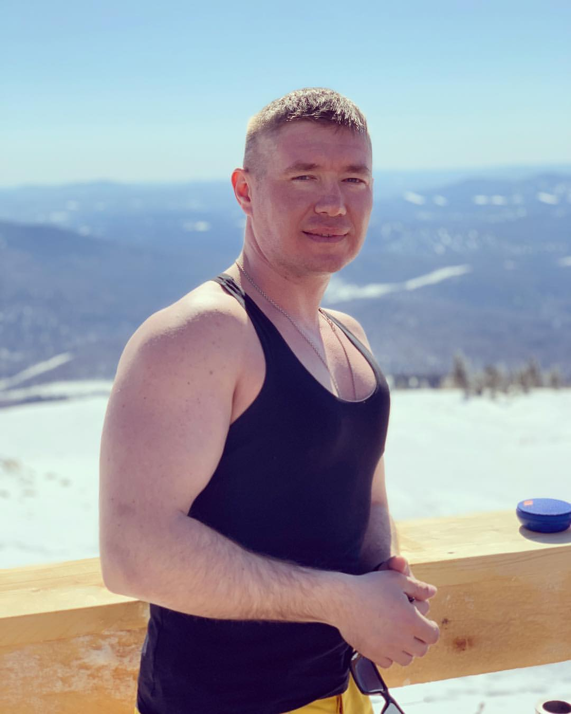

# Привет! Меня зовут Алексей

## Обо мне
Учусь на курсе Специалист по искусственному интеллекту. Люблю разбираться, как всё устроено.

## Чем занимаюсь
- Изучаю Git и GitHub
- Учу Python
- Читаю книги

## Мои цели
1. Освоить программирование
2. Найти интересное дело
3. Собрать портфолио

> Лучший способ учиться — делать.

## Ссылки
[Мой GitHub](https://github.com/alexen007)